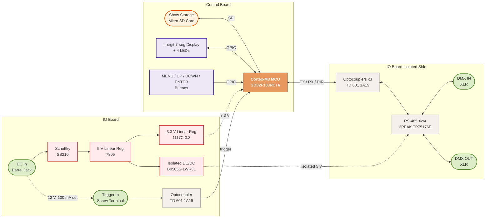

The Chauvet DMX-RT is a palm-sized box that records a DMX512 show from a lighting console and then plays it back on its own, with no computer or console attached. That makes it a handy way to run a canned light or animation sequence from a simple trigger.<!--more-->

Chauvet's DMX-RT is a compact DMX recording device with triggerable playback. You record a show from a DMX controller, then play it back from the front panel or from a trigger input that accepts a normally open or normally closed contact. It stores up to 999 shows and runs from a 12 VDC, 1 A external supply. Chauvet lists it as discontinued since 2023. The DMX-RT4 (four triggers, USB-C) has taken its place.

Writing show files from scratch is not a typical use, and Chauvet doesn't document the file format. I reverse engineered it and can generate shows myself. The [File Format](/Chauvet-DMX-RT-Teardown/#file-format) section covers the broad layout.

This is a look at the hardware of a retired design: what's on the two boards, how the pieces fit together, and what that tells us about how it works. Impatient readers can [skip straight to the block diagram.](/Chauvet-DMX-RT-Teardown/#system-architecture)

## Enclosure

The DMX-RT is a small black sheet-metal box, 3 x 2.9 x 1.7 in (77 x 73 x 43 mm), with an integrated mounting bracket. The top face has a four-digit seven-segment display, four buttons, and four status LEDs. The DMX connectors are XLRs on one end. The micro SD slot, DC power jack, and trigger terminal are on the side.

I like the construction. The enclosure is built from an upper and lower set of stamped sheet metal pieces which makes for a neat way to house a multi-board assembly with robustly mounted bulkhead connectors.

## Board Overview

The unit is built from two PCBs. The control board (silkscreen "BL-DMX-12V relay-M2.Pcb 2018.5.29") carries the MCU, display, buttons, LEDs, and micro SD socket. The I/O and power board (silkscreen "WM-DMX Relay-data1-V03 2019.04.22") carries the DC input, regulators, XLR connectors, and the DMX line interface. A 6-pin connector (labeled DMX-OUT1 on the control board and DMX-OUT2 on the I/O board) joins them. Six pins would be enough for 3.3 V, ground, DMX TX, DMX RX, DMX direction, and the trigger. That would account for everything that has to cross between the boards. To be clear, I did not trace these assumptions in detail.



## Control Board

{% include annotated_image.html
   image="/images/Chauvet_DMX-RT_Teardown/control_board_top.jpg"
   alt="Chauvet DMX-RT control board top view showing the GD32F103RCT6 microcontroller under a Chauvet version 1.0 sticker, 8 MHz crystal, four-digit display, buttons, LEDs, and micro SD socket"
   hotspots='[
     {"x":68.0,"y":22.0,"label":"GD32F103RCT6","desc":"GigaDevice GD32F103RCT6: Arm Cortex-M3 microcontroller, 108 MHz, 256 KB flash, 48 KB SRAM, LQFP64","url":"https://www.gd32mcu.com/data/documents/datasheet/GD32F103xx_Datasheet_Rev2.12.pdf"},
     {"x":93.2,"y":13.8,"label":"8 MHz crystal","desc":"Crystal marked 8.000 (MHz), presumably the MCU main oscillator"},
     {"x":52.0,"y":80.5,"label":"Micro SD","desc":"Micro SD socket for show storage"},
     {"x":51.5,"y":46.5,"label":"4-digit display","desc":"Four-digit seven-segment LED display, apparently driven directly by MCU GPIO (no driver IC)"},
     {"x":32.0,"y":14.5,"label":"6-pin connector","desc":"6-pin board-to-board connector (DMX-OUT1) carrying power and signals to the I/O board"}
   ]'
%}

### GD32F103RCT6: Main MCU

The brains are a **GigaDevice GD32F103RCT6**, an Arm Cortex-M3 microcontroller in a 64-pin LQFP. The GD32F103 family is GigaDevice's pin-compatible answer to the STM32F103. An 8 MHz crystal sits beside it. A Chauvet "DMX-RT Version 1.0" sticker covers the top of the package. The part marking underneath reads GD32F103 / RCT6 / DEGH072 / AC2126. The last line looks like a 2021 week 26 date code.

Per the <a href="https://www.gd32mcu.com/data/documents/datasheet/GD32F103xx_Datasheet_Rev2.12.pdf" target="_blank" rel="noopener">GD32F103xx datasheet</a> (Rev 2.12), the family runs its Cortex-M3 core at up to 108 MHz from a 2.6 to 3.6 V supply. The RC variant has 256 KB of flash and 48 KB of SRAM. The 64-pin package gives it enough GPIO to drive the display, buttons, and LEDs directly, and enough SPI and USART peripherals for everything else on the board.

Chauvet's manual shows what the firmware does with it. The menu on the four-digit display has four top-level entries: SEtU (trigger type, single-shot or looped playback, which file to play, delay, and how recording starts and stops), rECo (record a file), rUn (play a file by hand), and vEr (bootloader and application versions). Shows are numbered F000 to F999. The error codes tell us more: err1 through err7 cover file system initialization, a missing working directory, file creation, reading the DMX file tag, a bad file length, and failed DMX data reads. That list shows the firmware mounts a FAT file system on the card and checks a tag and length on each show file before playing it.


### Micro SD Storage

The micro SD socket holds the recorded show data. Chauvet specifies a card of up to 32 GB, Class 10 or faster, formatted FAT32. The MCU probably talks to the card over SPI.

Shows are stored as numbered .COD files, and the number matches the F000 to F999 file number on the display. The [File Format](/Chauvet-DMX-RT-Teardown/#file-format) section covers what is inside them.

### Display, Buttons, and LEDs

There's no display driver IC anywhere on the board. The four seven-segment digits appear to be driven directly from MCU GPIO, most likely multiplexed. The four buttons and four status LEDs also appear to connect straight to the MCU with only resistors in between.

## I/O and Power Board

{% include annotated_image.html
   image="/images/Chauvet_DMX-RT_Teardown/io_board_top.jpg"
   alt="Chauvet DMX-RT I/O and power board showing the DC jack, 7805 and 1117C-3.3 regulators, Mornsun isolated DC/DC converter, four TD 601 optocouplers, 3PEAK TP75176E RS-485 transceiver, and two XLR connectors"
   hotspots='[
     {"x":85.1,"y":69.2,"label":"6-pin connector","desc":"6-pin board-to-board connector (DMX-OUT2) carrying power and signals to the control board"},
     {"x":17.4,"y":63.0,"label":"7805","desc":"7805: 5 V linear regulator in a TO-252 package, the first stage after the DC jack","url":"https://www.st.com/resource/en/datasheet/l78.pdf"},
     {"x":55.5,"y":65.0,"label":"1117C-3.3","desc":"1117C-3.3: 3.3 V fixed linear regulator in SOT-223, feeding the 3.3 V logic including the MCU"},
     {"x":32.0,"y":59.5,"label":"B0505S-1WR3L","desc":"Mornsun B0505S-1WR3L: isolated 5 V to 5 V, 1 W DC/DC converter, powering the isolated DMX line side","url":"https://www.mornsun-power.com/public/uploads/pdf/B0505S-1WR3L.pdf"},
     {"x":43.7,"y":47.2,"label":"TP75176E","desc":"3PEAK TP75176E: RS-485 transceiver, the DMX line driver and receiver","url":"https://datasheet4u.com/download/1318218/TP75176E.html"},
     {"x":80.7,"y":49.2,"label":"TD 601","desc":"TD 601 1A19 optocoupler (DMX TX, RX, or direction control)"},
     {"x":68.1,"y":49.2,"label":"TD 601","desc":"TD 601 1A19 optocoupler (DMX TX, RX, or direction control)"},
     {"x":55.5,"y":49.2,"label":"TD 601","desc":"TD 601 1A19 optocoupler (DMX TX, RX, or direction control)"},
     {"x":70.1,"y":70.7,"label":"TD 601 (trigger)","desc":"TD 601 1A19 optocoupler, separate from the other three. Couples the trigger input to the MCU."},
     {"x":35.5,"y":86.5,"label":"SS210","desc":"SS210: 2 A, 100 V Schottky diode near the DC jack"}
   ]'
%}

### Power Supply

The DC jack feeds an SS210 Schottky diode, then a 7805 5 V linear regulator in a TO-252 package. Downstream of the 7805 is a 1117C-3.3, a 3.3 V fixed linear regulator in SOT-223. It supplies the MCU and the rest of the 3.3 V logic. A <a href="https://www.mornsun-power.com/public/uploads/pdf/B0505S-1WR3L.pdf" target="_blank" rel="noopener">Mornsun B0505S-1WR3L</a> isolated DC/DC converter (5 V in, 5 V out, 1 W) generates a separate isolated 5 V rail for the DMX line side. Mornsun rates its input to output isolation at 1.5 kVDC for one minute and 3 kVDC for one second.

### 3PEAK TP75176E: RS-485 Transceiver

DMX512 is a communication protocol that uses RS-485 for its physical signaling layer. The RS-485 interface is provided by a **3PEAK TP75176E** (<a href="https://datasheet4u.com/download/1318218/TP75176E.html" target="_blank" rel="noopener">datasheet</a>), a transceiver in the industry-standard 75176 pinout. It is powered from the isolated 5 V rail. A single transceiver serves both XLRs, working half-duplex: the DIR optocoupler switches it between receiving (recording from DMX IN) and driving (playing back to DMX OUT). Because the XLRs share one transceiver, DMX IN is not a pass-through. An upstream controller and the DMX-RT can't both drive the line at once.


### TD 601 Optocouplers

Four optocouplers marked "TD 601 1A19" sit on the I/O board, all in five-lead small-outline packages. Three of them are grouped together next to the XLRs and carry the DMX TX path, the DMX RX path, and the transmit/receive direction control across the isolation barrier. The fourth sits apart from the others, by the board-to-board connector, and couples the trigger input to the MCU.

The TD 601 looks like a logic-gate optocoupler in the HCPL-M601 family. Those are rated at 10 Mbd, far above the 250 kbit/s that DMX512 needs.


## System Architecture

The block diagram below shows how the major components *probably* interconnect, inferred from datasheet-typical usage and component placement, not verified traces. The GD32F103RCT6 sits at the center. The isolation barrier runs through the three DMX optocouplers and the Mornsun converter. The DMX line side is galvanically separate from the MCU and the DC input ground.



<div style="display:flex;flex-wrap:wrap;gap:8px;margin-top:6px;font-size:0.8em;font-family:sans-serif;">
  <span style="background:#e8985c;color:#fff;font-weight:bold;border:1px solid #333;padding:2px 8px;border-radius:3px;">MCU</span>
  <span style="background:#f5f0eb;color:#333;border:1px solid #999;padding:2px 8px;border-radius:3px;">Integrated Circuit</span>
  <span style="background:#ffebee;color:#333;border:2px solid #c62828;padding:2px 8px;border-radius:3px;">Power</span>
  <span style="background:#dcedc8;color:#333;border:2px solid #558b2f;padding:2px 8px;border-radius:3px;">Connector</span>
  <span style="background:#ede7f6;color:#333;border:2px solid #4527a0;padding:2px 8px;border-radius:3px;">Display / Switch</span>
  <span style="background:#fff3e0;color:#333;border:2px solid #e65100;padding:2px 8px;border-radius:3px;">Storage</span>
</div>

## Design Notes

The DMX-RT is a tidy, conventional design. One microcontroller does everything, one RS-485 transceiver handles the DMX line, and two linear regulators cover power. The GD32F103 in place of an STM32F103 looks like a routine cost decision on a pin-compatible Cortex-M3.

The DMX interface is isolated from the logic with optocouplers and an isolated 5 V converter. That is good practice.

The transceiver is shared between the two XLRs and between transmit and receive. The DMX-RT can listen or drive the line but not both. It can't pass DMX through, and it can't be triggered by a master DMX controller to play back a recording. The DMX-RT4 adds that: its manual describes a DMX Trigger Option that lets a DMX signal trigger four scenes. I've used it on another project and it works well. It's a nice upgrade if you want to give a client a show that their existing DMX system can trigger, and the same goes for the client's client, and their client, down n levels of subcontractors. You buy it once and the whole chain benefits. The payoff is O(n). Everyone subcontracts everything, and n is rarely small.

## File Format

Chauvet doesn't publish the DMX-RT's show file format. I worked it out from five recordings made on the unit. That lets me build shows in my own tooling and copy them to the card instead of recording them live. Everything below is reverse engineered, not official.

Show files live on the card as `RECORDER/REC000.COD`, `REC001.COD`, and so on. Each file is a 512-byte preamble, then a series of fixed-size records with one record per DMX frame, then a short run of zero padding.

```
Preamble         512 bytes
Record 0         19-byte header + one byte per DMX channel
Record 1         ...
...
Record N-1
Trailing pad     16 to 452 bytes of zeros in the captures
```

The preamble is almost entirely zeros. Its one meaningful field is the highest value of the seconds counter (see below), stored twice as a 32-bit little-endian integer. In practice that is the show length in seconds minus one.

Each record starts with a 19-byte header:

| Field           | Size    | Meaning                                              |
| --------------- | ------- | ---------------------------------------------------- |
| Tag             | 8 bytes | The ASCII string "framedmx"                          |
| Version         | 1 byte  | Always 1 in the captures                             |
| Channel count   | 2 bytes | Big-endian, the same in every record of a file       |
| Frame interval  | 2 bytes | Time between frames in 10 µs units (3333 is 30 fps) |
| Seconds counter | 1 byte  | Elapsed seconds since the show started               |
| Reserved        | 5 bytes | Zeros, in two groups                                 |

The header is followed by one byte for each DMX channel. The preamble is little-endian while the channel count and frame interval are big-endian, which is an odd mix.

Nothing in the file separates these parts. The preamble is simply the first 512 bytes, and the first record starts right after it. Records run back to back, and each one is 19 bytes plus its channel count, so record n starts at 512 + n × (19 + channel count). The channel count is stored in the record headers rather than the preamble, which means the first record's header has to be read before the rest can be found. There is no record count or length field anywhere. The "framedmx" tag marks the start of each record, and the records end at the first place where the tag is missing. Everything after that is padding.

The frame interval is what sets playback speed. Leave it at zero and the DMX-RT plays the frames as fast as it can render them, which looks like a very fast show. A 512-channel record is 531 bytes, so a 30 second show at 30 fps comes to about 478 KB.

A few details are still unexplained, including the trailing pad and what makes the recorder roll over to a second file.

## Resources

* DMX-RT product page - <a href="https://www.chauvetdj.com/products/dmx-rt/" target="_blank" rel="noopener">Chauvet</a>
* DMX-RT User Manual (Rev. 6) - <a href="https://www.chauvetdj.com/wp-content/uploads/2016/09/DMX-RT-UM-Rev6.pdf" target="_blank" rel="noopener">Chauvet</a>
* DMX-RT Quick Reference Guide - <a href="https://www.chauvetdj.com/wp-content/uploads/2016/09/DMX-RT_QRG_Rev5_ML5.pdf" target="_blank" rel="noopener">Chauvet</a>
* DMX-RT4 User Manual (Rev. 1) - <a href="https://www.chauvetdj.com/wp-content/uploads/2023/02/DMX_RT4_UM_Rev1.pdf" target="_blank" rel="noopener">Chauvet</a>

## Disclaimer

This analysis is based entirely on visual inspection, component identification, and datasheet research. The block diagrams and interconnections are inferred from datasheet-typical usage patterns and the physical placement of components on the PCB, not from verified traces. Some assumptions are almost certainly wrong.

This is a hobbyist exercise in engineering curiosity, not a competitive analysis or a criticism of Chauvet's engineering.
